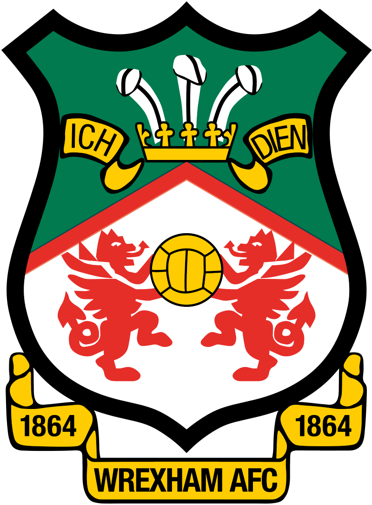

# WrexhamAFC-DataAnalysis

Analysis of Wrexham AFC data comparing performance in their league, looking at their data and comparing how they rank compared to previous teams promoted from the league. 

## Aims and Objectives: 
- Web scrape data from [FBREF](https://fbref.com/en/squads/dad7970b/Wrexham-Stats)
- Analysis of Wrexham AFC 
- Comparison of Wrexham to other teams competing in similar competitions
